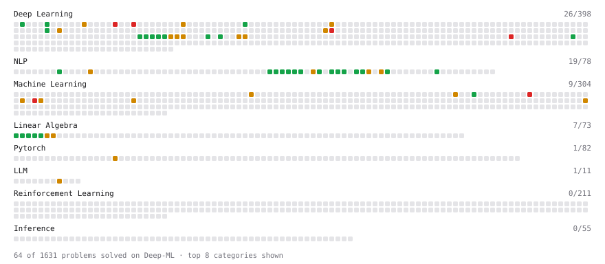

# Deep-ML

My machine learning practice from [Deep-ML](https://www.deep-ml.com). Every solution here was written by hand.

**153** solved · 118 problems · 12 labs · 23 math

[**Browse the interactive portfolio**](https://taruki11.github.io/deep-ml/) to replay this filling in over time.

## Problems

| | Difficulty | Solved | |
| --- | --- | --- | --- |
| [Add Positional Embeddings to Token Embeddings](https://www.deep-ml.com/problems/946) | easy | 2026-10-01 | [solution](problems/0946-add-positional-embeddings-to-token-embeddings) |
| [Apply Dropout to Attention Weights](https://www.deep-ml.com/problems/956) | easy | 2026-10-01 | [solution](problems/0956-apply-dropout-to-attention-weights) |
| [Average Negative Log-Likelihood for Bigram Model](https://www.deep-ml.com/problems/986) | easy | 2026-10-01 | [solution](problems/0986-average-negative-log-likelihood-for-bigram-model) |
| [BPE Decode Token IDs to Text](https://www.deep-ml.com/problems/951) | easy | 2026-10-01 | [solution](problems/0951-bpe-decode-token-ids-to-text) |
| [Build a Dataset and Use It with a DataLoader](https://www.deep-ml.com/problems/899) | easy | 2026-10-26 | [solution](problems/0899-build-a-dataset-and-use-it-with-a-dataloader) |
| [Build a Linear Regression Model with nn.Module](https://www.deep-ml.com/problems/885) | easy | 2026-10-25 | [solution](problems/0885-build-a-linear-regression-model-with-nn-module) |
| [Build an MLP with nn.Sequential](https://www.deep-ml.com/problems/887) | easy | 2026-10-25 | [solution](problems/0887-build-an-mlp-with-nn-sequential) |
| [Build Bigram Count Matrix from Words](https://www.deep-ml.com/problems/983) | easy | 2026-10-01 | [solution](problems/0983-build-bigram-count-matrix-from-words) |
| [Build Vocabulary from Token List](https://www.deep-ml.com/problems/941) | easy | 2026-09-15 | [solution](problems/0941-build-vocabulary-from-token-list) |
| [Calculate Mean by Row or Column](https://www.deep-ml.com/problems/4) | easy | 2026-08-28 | [solution](problems/0004-calculate-mean-by-row-or-column) |
| [Calculate Perplexity for Language Models](https://www.deep-ml.com/problems/320) | easy | 2026-09-15 | [solution](problems/0320-calculate-perplexity-for-language-models) |
| [Calculate Vocabulary Size from Token List](https://www.deep-ml.com/problems/953) | easy | 2026-09-30 | [solution](problems/0953-calculate-vocabulary-size-from-token-list) |
| [Compute a Gradient with PyTorch Autograd](https://www.deep-ml.com/problems/884) | easy | 2026-10-25 | [solution](problems/0884-compute-a-gradient-with-pytorch-autograd) |
| [Compute a Gradient with Tinygrad Autograd](https://www.deep-ml.com/problems/893) | easy | 2026-10-27 | [solution](problems/0893-compute-a-gradient-with-tinygrad-autograd) |
| [Compute Multi-class Cross-Entropy Loss](https://www.deep-ml.com/problems/134) | easy | 2026-09-14 | [solution](problems/0134-compute-multi-class-cross-entropy-loss) |
| [Construct Causal Attention Mask via tril and triu Methods](https://www.deep-ml.com/problems/965) | easy | 2026-10-01 | [solution](problems/0965-construct-causal-attention-mask-via-tril-and-triu-methods) |
| [Construct Next-Token Prediction Targets](https://www.deep-ml.com/problems/954) | easy | 2026-10-01 | [solution](problems/0954-construct-next-token-prediction-targets) |
| [Create a Float Tensor from a Python List](https://www.deep-ml.com/problems/880) | easy | 2026-10-25 | [solution](problems/0880-create-a-float-tensor-from-a-python-list) |
| [Create a Float Tensor with Tinygrad](https://www.deep-ml.com/problems/889) | easy | 2026-10-27 | [solution](problems/0889-create-a-float-tensor-with-tinygrad) |
| [Derivatives of Activation Functions](https://www.deep-ml.com/problems/217) | easy | 2026-10-25 | [solution](problems/0217-derivatives-of-activation-functions) |
| [Embedding Layer as One-Hot Matrix Multiplication](https://www.deep-ml.com/problems/947) | easy | 2026-10-01 | [solution](problems/0947-embedding-layer-as-one-hot-matrix-multiplication) |
| [Find Most Frequent Token Pair for BPE](https://www.deep-ml.com/problems/948) | easy | 2026-09-30 | [solution](problems/0948-find-most-frequent-token-pair-for-bpe) |
| [Generate Input-Target Batches for Language Model Training](https://www.deep-ml.com/problems/1080) | easy | 2026-10-01 | [solution](problems/1080-generate-input-target-batches-for-language-model-training) |
| [Greedy Autoregressive Text Generation](https://www.deep-ml.com/problems/1070) | easy | 2026-10-02 | [solution](problems/1070-greedy-autoregressive-text-generation) |
| [Implement a Simple Residual Block with Shortcut Connection](https://www.deep-ml.com/problems/113) | easy | 2026-10-27 | [solution](problems/0113-implement-a-simple-residual-block-with-shortcut-connection) |
| [Implement Global Average Pooling](https://www.deep-ml.com/problems/114) | easy | 2026-10-27 | [solution](problems/0114-implement-global-average-pooling) |
| [Implement Hinge Loss for SVM](https://www.deep-ml.com/problems/283) | easy | 2026-10-22 | [solution](problems/0283-implement-hinge-loss-for-svm) |
| [Implementation of Log Softmax Function](https://www.deep-ml.com/problems/39) | easy | 2026-09-14 | [solution](problems/0039-implementation-of-log-softmax-function) |
| [Laplace Smoothing for Bigram Probabilities](https://www.deep-ml.com/problems/987) | easy | 2026-10-01 | [solution](problems/0987-laplace-smoothing-for-bigram-probabilities) |
| [Learned Positional Embeddings](https://www.deep-ml.com/problems/375) | easy | 2026-10-02 | [solution](problems/0375-learned-positional-embeddings) |
| [Matrix-Vector Dot Product](https://www.deep-ml.com/problems/1) | easy | 2026-08-28 | [solution](problems/0001-matrix-vector-dot-product) |
| [Momentum Optimizer](https://www.deep-ml.com/problems/146) | easy | 2026-10-27 | [solution](problems/0146-momentum-optimizer) |
| [Naive and Seasonal-Naive Forecast Baselines](https://www.deep-ml.com/problems/1382) | easy | 2026-10-22 | [solution](problems/1382-naive-and-seasonal-naive-forecast-baselines) |
| [Pad and Truncate Tokenized Sequences](https://www.deep-ml.com/problems/1059) | easy | 2026-10-01 | [solution](problems/1059-pad-and-truncate-tokenized-sequences) |
| [Regex-Based Text Tokenizer](https://www.deep-ml.com/problems/940) | easy | 2026-09-15 | [solution](problems/0940-regex-based-text-tokenizer) |
| [Reshape Matrix](https://www.deep-ml.com/problems/3) | easy | 2026-08-28 | [solution](problems/0003-reshape-matrix) |
| [Run One Training Step: Forward, Loss, Backward, Optimizer](https://www.deep-ml.com/problems/886) | easy | 2026-10-25 | [solution](problems/0886-run-one-training-step-forward-loss-backward-optimizer) |
| [Scalar Multiplication of a Matrix](https://www.deep-ml.com/problems/5) | easy | 2026-08-28 | [solution](problems/0005-scalar-multiplication-of-a-matrix) |
| [Scale Attention Scores by sqrt(d_k)](https://www.deep-ml.com/problems/963) | easy | 2026-10-01 | [solution](problems/0963-scale-attention-scores-by-sqrt-d-k) |
| [Simple Self-Attention Without Trainable Weights](https://www.deep-ml.com/problems/955) | easy | 2026-10-01 | [solution](problems/0955-simple-self-attention-without-trainable-weights) |
| [Simple Word Tokenizer Encode and Decode](https://www.deep-ml.com/problems/942) | easy | 2026-09-30 | [solution](problems/0942-simple-word-tokenizer-encode-and-decode) |
| [Sliding Window Text Dataset Generator](https://www.deep-ml.com/problems/944) | easy | 2026-10-01 | [solution](problems/0944-sliding-window-text-dataset-generator) |
| [Softmax Activation Function Implementation ](https://www.deep-ml.com/problems/23) | easy | 2026-09-14 | [solution](problems/0023-softmax-activation-function-implementation) |
| [Token Embedding Lookup Table](https://www.deep-ml.com/problems/945) | easy | 2026-10-01 | [solution](problems/0945-token-embedding-lookup-table) |
| [Tokenizer with Unknown and End-of-Text Tokens](https://www.deep-ml.com/problems/943) | easy | 2026-09-30 | [solution](problems/0943-tokenizer-with-unknown-and-end-of-text-tokens) |
| [Transpose of a Matrix](https://www.deep-ml.com/problems/2) | easy | 2026-08-28 | [solution](problems/0002-transpose-of-a-matrix) |
| [Your First Gradient with jax.grad](https://www.deep-ml.com/problems/1325) | easy | 2026-10-27 | [solution](problems/1325-your-first-gradient-with-jax-grad) |
| [Apply a 2D Convolution](https://www.deep-ml.com/problems/1233) | medium | 2026-10-27 | [solution](problems/1233-apply-a-2d-convolution) |
| [Backpropagation Gradients for a Dense Layer](https://www.deep-ml.com/problems/1076) | medium | 2026-10-25 | [solution](problems/1076-backpropagation-gradients-for-a-dense-layer) |
| [BM25 Ranking ](https://www.deep-ml.com/problems/90) | medium | 2026-10-22 | [solution](problems/0090-bm25-ranking) |
| [BPE Encode Text Using Merge Table](https://www.deep-ml.com/problems/950) | medium | 2026-10-01 | [solution](problems/0950-bpe-encode-text-using-merge-table) |
| [Build Scaled Dot-Product Attention](https://www.deep-ml.com/problems/490) | medium | 2026-10-01 | [solution](problems/0490-build-scaled-dot-product-attention) |
| [Byte Pair Encoding (BPE) Tokenizer](https://www.deep-ml.com/problems/380) | medium | 2026-10-01 | [solution](problems/0380-byte-pair-encoding-bpe-tokenizer) |
| [Calculate Eigenvalues of a Matrix](https://www.deep-ml.com/problems/6) | medium | 2026-08-28 | [solution](problems/0006-calculate-eigenvalues-of-a-matrix) |
| [CosineAnnealingLR Learning Rate Scheduler](https://www.deep-ml.com/problems/155) | medium | 2026-10-27 | [solution](problems/0155-cosineannealinglr-learning-rate-scheduler) |
| [Differencing and a Rolling-Statistics Stationarity Check](https://www.deep-ml.com/problems/1353) | medium | 2026-10-22 | [solution](problems/1353-differencing-and-a-rolling-statistics-stationarity-check) |
| [Dropout Layer](https://www.deep-ml.com/problems/151) | medium | 2026-10-27 | [solution](problems/0151-dropout-layer) |
| [Entropy & Cross-Entropy](https://www.deep-ml.com/problems/205) | medium | 2026-09-15 | [solution](problems/0205-entropy-cross-entropy) |
| [Generate Sorted Polynomial Features](https://www.deep-ml.com/problems/32) | medium | 2026-10-22 | [solution](problems/0032-generate-sorted-polynomial-features) |
| [Gradient Accumulation Over Micro-Batches](https://www.deep-ml.com/problems/912) | medium | 2026-10-27 | [solution](problems/0912-gradient-accumulation-over-micro-batches) |
| [Gradient Clipping by Global Norm](https://www.deep-ml.com/problems/197) | medium | 2026-10-27 | [solution](problems/0197-gradient-clipping-by-global-norm) |
| [Greedy Streaming Decoder with KV Cache](https://www.deep-ml.com/problems/1055) | medium | 2026-10-02 | [solution](problems/1055-greedy-streaming-decoder-with-kv-cache) |
| [Implement a ResNet Basic Block](https://www.deep-ml.com/problems/917) | medium | 2026-10-27 | [solution](problems/0917-implement-a-resnet-basic-block) |
| [Implement a Transformer Encoder Block](https://www.deep-ml.com/problems/905) | medium | 2026-10-02 | [solution](problems/0905-implement-a-transformer-encoder-block) |
| [Implement Adam Optimization Algorithm](https://www.deep-ml.com/problems/49) | medium | 2026-10-27 | [solution](problems/0049-implement-adam-optimization-algorithm) |
| [Implement AdamW Optimizer Step](https://www.deep-ml.com/problems/169) | medium | 2026-10-27 | [solution](problems/0169-implement-adamw-optimizer-step) |
| [Implement Batch Normalization for BCHW Input](https://www.deep-ml.com/problems/115) | medium | 2026-10-27 | [solution](problems/0115-implement-batch-normalization-for-bchw-input) |
| [Implement Batched Causal Self-Attention](https://www.deep-ml.com/problems/957) | medium | 2026-10-02 | [solution](problems/0957-implement-batched-causal-self-attention) |
| [Implement DBSCAN Clustering Algorithm](https://www.deep-ml.com/problems/259) | medium | 2026-10-22 | [solution](problems/0259-implement-dbscan-clustering-algorithm) |
| [Implement Gaussian Mixture Model (GMM) E-step](https://www.deep-ml.com/problems/365) | medium | 2026-10-22 | [solution](problems/0365-implement-gaussian-mixture-model-gmm-e-step) |
| [Implement Gaussian Mixture Model (GMM) M-step](https://www.deep-ml.com/problems/366) | medium | 2026-10-22 | [solution](problems/0366-implement-gaussian-mixture-model-gmm-m-step) |
| [Implement Gradient Boosting Regressor Step](https://www.deep-ml.com/problems/344) | medium | 2026-10-22 | [solution](problems/0344-implement-gradient-boosting-regressor-step) |
| [Implement K-Means++ Initialization](https://www.deep-ml.com/problems/362) | medium | 2026-10-22 | [solution](problems/0362-implement-k-means-initialization) |
| [Implement Layer Normalization for Sequence Data](https://www.deep-ml.com/problems/109) | medium | 2026-10-02 | [solution](problems/0109-implement-layer-normalization-for-sequence-data) |
| [Implement Masked Self-Attention](https://www.deep-ml.com/problems/107) | medium | 2026-10-02 | [solution](problems/0107-implement-masked-self-attention) |
| [Implement Position-wise Feed-Forward Block with Residual and Dropout](https://www.deep-ml.com/problems/178) | medium | 2026-10-02 | [solution](problems/0178-implement-position-wise-feed-forward-block-with-residual-and-dropout) |
| [Implement RBF (Gaussian) Kernel Function](https://www.deep-ml.com/problems/280) | medium | 2026-10-22 | [solution](problems/0280-implement-rbf-gaussian-kernel-function) |
| [Implement Self-Attention Mechanism](https://www.deep-ml.com/problems/53) | medium | 2026-10-01 | [solution](problems/0053-implement-self-attention-mechanism) |
| [Implement TF-IDF (Term Frequency-Inverse Document Frequency)](https://www.deep-ml.com/problems/60) | medium | 2026-10-22 | [solution](problems/0060-implement-tf-idf-term-frequency-inverse-document-frequency) |
| [Implement Xavier/Glorot Weight Initialization](https://www.deep-ml.com/problems/289) | medium | 2026-10-25 | [solution](problems/0289-implement-xavier-glorot-weight-initialization) |
| [Implementing Basic Autograd Operations](https://www.deep-ml.com/problems/26) | medium | 2026-10-25 | [solution](problems/0026-implementing-basic-autograd-operations) |
| [K-Means Clustering](https://www.deep-ml.com/problems/17) | medium | 2026-10-22 | [solution](problems/0017-k-means-clustering) |
| [Local Outlier Factor (LOF) Anomaly Score](https://www.deep-ml.com/problems/830) | medium | 2026-10-22 | [solution](problems/0830-local-outlier-factor-lof-anomaly-score) |
| [Matrix Transformation ](https://www.deep-ml.com/problems/7) | medium | 2026-08-28 | [solution](problems/0007-matrix-transformation) |
| [Mixed-Precision Forward with `autocast`](https://www.deep-ml.com/problems/911) | medium | 2026-10-27 | [solution](problems/0911-mixed-precision-forward-with-autocast) |
| [MLP Character-Level Language Model Forward Pass](https://www.deep-ml.com/problems/989) | medium | 2026-10-01 | [solution](problems/0989-mlp-character-level-language-model-forward-pass) |
| [Multi-Head Attention via Head Stacking](https://www.deep-ml.com/problems/958) | medium | 2026-10-02 | [solution](problems/0958-multi-head-attention-via-head-stacking) |
| [Multi-Head Attention with Combined QKV Weight Matrix](https://www.deep-ml.com/problems/959) | medium | 2026-10-02 | [solution](problems/0959-multi-head-attention-with-combined-qkv-weight-matrix) |
| [Numerically Stable Cross-Entropy](https://www.deep-ml.com/problems/914) | medium | 2026-10-27 | [solution](problems/0914-numerically-stable-cross-entropy) |
| [Random Forest Fit from Scratch](https://www.deep-ml.com/problems/807) | medium | 2026-10-22 | [solution](problems/0807-random-forest-fit-from-scratch) |
| [Ranking Metrics: NDCG@k, MRR and MAP@k](https://www.deep-ml.com/problems/1408) | medium | 2026-10-22 | [solution](problems/1408-ranking-metrics-ndcg-k-mrr-and-map-k) |
| [Reconstruction Error from PCA](https://www.deep-ml.com/problems/353) | medium | 2026-10-22 | [solution](problems/0353-reconstruction-error-from-pca) |
| [Rotary Positional Embeddings (RoPE)](https://www.deep-ml.com/problems/381) | medium | 2026-10-02 | [solution](problems/0381-rotary-positional-embeddings-rope) |
| [Sample from MLP Character Language Model](https://www.deep-ml.com/problems/991) | medium | 2026-10-01 | [solution](problems/0991-sample-from-mlp-character-language-model) |
| [Sentiment Classifier: fit/predict with TF-IDF Features](https://www.deep-ml.com/problems/1248) | medium | 2026-10-22 | [solution](problems/1248-sentiment-classifier-fit-predict-with-tf-idf-features) |
| [Silhouette Score for Clustering Evaluation](https://www.deep-ml.com/problems/254) | medium | 2026-10-22 | [solution](problems/0254-silhouette-score-for-clustering-evaluation) |
| [Simple Convolutional 2D Layer](https://www.deep-ml.com/problems/41) | medium | 2026-10-27 | [solution](problems/0041-simple-convolutional-2d-layer) |
| [Single Neuron with Backpropagation](https://www.deep-ml.com/problems/25) | medium | 2026-10-25 | [solution](problems/0025-single-neuron-with-backpropagation) |
| [Sobel Edge Detection](https://www.deep-ml.com/problems/241) | medium | 2026-10-27 | [solution](problems/0241-sobel-edge-detection) |
| [Spectral Clustering via Graph Laplacian](https://www.deep-ml.com/problems/824) | medium | 2026-10-22 | [solution](problems/0824-spectral-clustering-via-graph-laplacian) |
| [Step Functions, Cubic Splines and the Natural Spline Basis](https://www.deep-ml.com/problems/1418) | medium | 2026-10-22 | [solution](problems/1418-step-functions-cubic-splines-and-the-natural-spline-basis) |
| [SVM Dual Formulation via Coordinate Descent](https://www.deep-ml.com/problems/814) | medium | 2026-10-22 | [solution](problems/0814-svm-dual-formulation-via-coordinate-descent) |
| [Temperature Sampling](https://www.deep-ml.com/problems/378) | medium | 2026-10-02 | [solution](problems/0378-temperature-sampling) |
| [Top-p (Nucleus) Sampling](https://www.deep-ml.com/problems/383) | medium | 2026-10-02 | [solution](problems/0383-top-p-nucleus-sampling) |
| [Train Bigram Language Model as a Neural Network](https://www.deep-ml.com/problems/988) | medium | 2026-10-01 | [solution](problems/0988-train-bigram-language-model-as-a-neural-network) |
| [Vectorizing with jax.vmap](https://www.deep-ml.com/problems/1328) | medium | 2026-10-27 | [solution](problems/1328-vectorizing-with-jax-vmap) |
| [XGBoost Objective Function Calculation](https://www.deep-ml.com/problems/347) | medium | 2026-10-22 | [solution](problems/0347-xgboost-objective-function-calculation) |
| [Build a Transformer Encoder Layer](https://www.deep-ml.com/problems/491) | hard | 2026-10-02 | [solution](problems/0491-build-a-transformer-encoder-layer) |
| [Generalized Additive Model by Backfitting](https://www.deep-ml.com/problems/1420) | hard | 2026-10-22 | [solution](problems/1420-generalized-additive-model-by-backfitting) |
| [Implement Bagging Classifier from Scratch](https://www.deep-ml.com/problems/307) | hard | 2026-10-22 | [solution](problems/0307-implement-bagging-classifier-from-scratch) |
| [Implement Multi-Head Attention](https://www.deep-ml.com/problems/94) | hard | 2026-10-02 | [solution](problems/0094-implement-multi-head-attention) |
| [Implement Stacking Classifier](https://www.deep-ml.com/problems/346) | hard | 2026-10-22 | [solution](problems/0346-implement-stacking-classifier) |
| [IoU and Mean Average Precision for Object Detection](https://www.deep-ml.com/problems/1395) | hard | 2026-10-27 | [solution](problems/1395-iou-and-mean-average-precision-for-object-detection) |
| [Pegasos Kernel SVM Implementation](https://www.deep-ml.com/problems/21) | hard | 2026-10-22 | [solution](problems/0021-pegasos-kernel-svm-implementation) |
| [Positional Encoding Calculator](https://www.deep-ml.com/problems/85) | hard | 2026-10-02 | [solution](problems/0085-positional-encoding-calculator) |
| [Pre-Norm GPT Transformer Block Forward Pass](https://www.deep-ml.com/problems/1056) | hard | 2026-10-02 | [solution](problems/1056-pre-norm-gpt-transformer-block-forward-pass) |
| [Singular Value Decomposition (SVD) of 2x2 Matrix](https://www.deep-ml.com/problems/12) | hard | 2026-10-22 | [solution](problems/0012-singular-value-decomposition-svd-of-2x2-matrix) |
| [Trade Compute for Memory with Gradient Checkpointing](https://www.deep-ml.com/problems/1342) | hard | 2026-10-27 | [solution](problems/1342-trade-compute-for-memory-with-gradient-checkpointing) |

## Labs

| | Difficulty | Solved | |
| --- | --- | --- | --- |
| [PyTorch: Build a Complete Training Loop](https://www.deep-ml.com/labs/13) | easy | 2026-10-27 | [solution](labs/0013-pytorch-build-a-complete-training-loop) |
| [Train a Binary Classifier](https://www.deep-ml.com/labs/23) | easy | 2026-10-23 | [solution](labs/0023-train-a-binary-classifier) |
| [Build a Tokenizer for Language Modeling](https://www.deep-ml.com/labs/19) | medium | 2026-10-01 | [solution](labs/0019-build-a-tokenizer-for-language-modeling) |
| [Combine Trained Models into an Ensemble](https://www.deep-ml.com/labs/27) | medium | 2026-10-26 | [solution](labs/0027-combine-trained-models-into-an-ensemble) |
| [Design Your Own Attention Mechanism](https://www.deep-ml.com/labs/10) | medium | 2026-10-02 | [solution](labs/0010-design-your-own-attention-mechanism) |
| [Design Your Own Optimizer (NumPy)](https://www.deep-ml.com/labs/8) | medium | 2026-10-28 | [solution](labs/0008-design-your-own-optimizer-numpy) |
| [Few-Shot Classification with Cluster-Based Label Propagation](https://www.deep-ml.com/labs/28) | medium | 2026-10-25 | [solution](labs/0028-few-shot-classification-with-cluster-based-label-propagation) |
| [Fix Overfitting with Regularization (NumPy)](https://www.deep-ml.com/labs/21) | medium | 2026-10-27 | [solution](labs/0021-fix-overfitting-with-regularization-numpy) |
| [MNIST: Fix Very Deep Network Training](https://www.deep-ml.com/labs/7) | medium | 2026-10-28 | [solution](labs/0007-mnist-fix-very-deep-network-training) |
| [Numpy: Design Your Own Dimensionality Reduction](https://www.deep-ml.com/labs/14) | medium | 2026-10-23 | [solution](labs/0014-numpy-design-your-own-dimensionality-reduction) |
| [Build a Tree for a Random Forest](https://www.deep-ml.com/labs/26) | hard | 2026-10-25 | [solution](labs/0026-build-a-tree-for-a-random-forest) |
| [MNIST: Build Neural Network from Scratch (NumPy Only)](https://www.deep-ml.com/labs/6) | hard | 2026-10-26 | [solution](labs/0006-mnist-build-neural-network-from-scratch-numpy-only) |

## Math

| | Difficulty | Solved | |
| --- | --- | --- | --- |
| [Derivatives and Gradients](https://www.deep-ml.com/math-problems/1) | easy | 2026-09-15 | [solution](math/0001-derivatives-and-gradients) |
| [Gradient Descent Updates](https://www.deep-ml.com/math-problems/5) | easy | 2026-09-15 | [solution](math/0005-gradient-descent-updates) |
| [Adam Bias Correction](https://www.deep-ml.com/math-problems/132) | medium | 2026-10-27 | [solution](math/0132-adam-bias-correction) |
| [Backpropagation and the Chain Rule](https://www.deep-ml.com/math-problems/4) | medium | 2026-10-01 | [solution](math/0004-backpropagation-and-the-chain-rule) |
| [Convolution Arithmetic and Parameter Sharing](https://www.deep-ml.com/math-problems/116) | medium | 2026-10-27 | [solution](math/0116-convolution-arithmetic-and-parameter-sharing) |
| [Cubic and Natural Splines: Knots and Degrees of Freedom](https://www.deep-ml.com/math-problems/96) | medium | 2026-10-22 | [solution](math/0096-cubic-and-natural-splines-knots-and-degrees-of-freedom) |
| [Information Theory: Entropy](https://www.deep-ml.com/math-problems/24) | medium | 2026-09-14 | [solution](math/0024-information-theory-entropy) |
| [Log-Likelihood Gradients](https://www.deep-ml.com/math-problems/38) | medium | 2026-09-14 | [solution](math/0038-log-likelihood-gradients) |
| [Margins and Soft-Margin SVMs](https://www.deep-ml.com/math-problems/42) | medium | 2026-10-22 | [solution](math/0042-margins-and-soft-margin-svms) |
| [Matrix Calculus Identities](https://www.deep-ml.com/math-problems/35) | medium | 2026-10-01 | [solution](math/0035-matrix-calculus-identities) |
| [Neural Network Derivatives](https://www.deep-ml.com/math-problems/3) | medium | 2026-10-01 | [solution](math/0003-neural-network-derivatives) |
| [PCA via Covariance Eigendecomposition](https://www.deep-ml.com/math-problems/49) | medium | 2026-10-22 | [solution](math/0049-pca-via-covariance-eigendecomposition) |
| [Softmax and Cross-Entropy](https://www.deep-ml.com/math-problems/32) | medium | 2026-09-14 | [solution](math/0032-softmax-and-cross-entropy) |
| [The EM Algorithm](https://www.deep-ml.com/math-problems/41) | medium | 2026-10-22 | [solution](math/0041-the-em-algorithm) |
| [The K-Means Objective and Lloyd's Algorithm](https://www.deep-ml.com/math-problems/120) | medium | 2026-10-22 | [solution](math/0120-the-k-means-objective-and-lloyd-s-algorithm) |
| [Training Error, Test Error and the Bayes Rate](https://www.deep-ml.com/math-problems/104) | medium | 2026-10-25 | [solution](math/0104-training-error-test-error-and-the-bayes-rate) |
| [Variance Preservation and He/Glorot Scaling](https://www.deep-ml.com/math-problems/131) | medium | 2026-10-25 | [solution](math/0131-variance-preservation-and-he-glorot-scaling) |
| [Bagging, Variance Reduction and Random Forests](https://www.deep-ml.com/math-problems/114) | hard | 2026-10-22 | [solution](math/0114-bagging-variance-reduction-and-random-forests) |
| [Boosting: Learning Slowly from Residuals](https://www.deep-ml.com/math-problems/115) | hard | 2026-10-22 | [solution](math/0115-boosting-learning-slowly-from-residuals) |
| [Eigendecomposition and SVD](https://www.deep-ml.com/math-problems/16) | hard | 2026-10-22 | [solution](math/0016-eigendecomposition-and-svd) |
| [KL Divergence](https://www.deep-ml.com/math-problems/25) | hard | 2026-10-02 | [solution](math/0025-kl-divergence) |
| [Local Regression and Generalized Additive Models](https://www.deep-ml.com/math-problems/111) | hard | 2026-10-22 | [solution](math/0111-local-regression-and-generalized-additive-models) |
| [Recurrent Networks, Weight Sharing and Vanishing Gradients](https://www.deep-ml.com/math-problems/117) | hard | 2026-10-28 | [solution](math/0117-recurrent-networks-weight-sharing-and-vanishing-gradients) |

---

_This file is regenerated by Deep-ML on every push._
