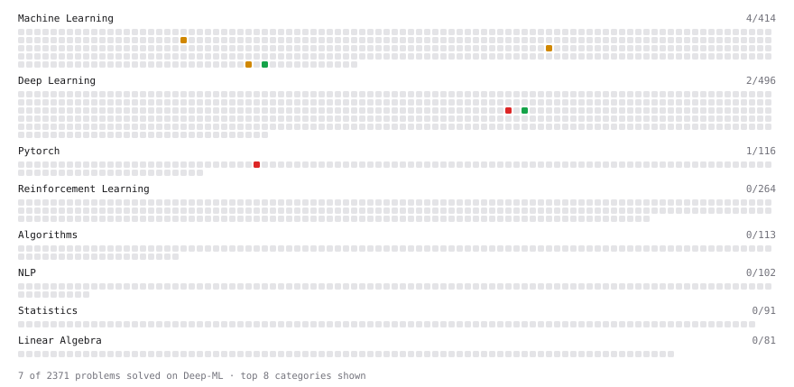

# Deep-ML

My machine learning practice from [Deep-ML](https://www.deep-ml.com). Every solution here was written by hand.

**20** solved · 14 problems · 2 labs · 4 math

[**Browse the interactive portfolio**](https://taruki11.github.io/deep-ml/) to replay this filling in over time.

## Problems

| | Difficulty | Solved | |
| --- | --- | --- | --- |
| [Discretise a Selective SSM: Zero-Order Hold vs Euler](https://www.deep-ml.com/problems/1646) | easy | 2026-11-21 | [solution](problems/1646-discretise-a-selective-ssm-zero-order-hold-vs-euler) |
| [Forecast Error Metrics: MAPE, sMAPE and MASE with Their Edge Cases](https://www.deep-ml.com/problems/2210) | easy | 2026-11-19 | [solution](problems/2210-forecast-error-metrics-mape-smape-and-mase-with-their-edge-cases) |
| [Implement Weight Tying Between Embedding and LM Head](https://www.deep-ml.com/problems/1026) | easy | 2026-11-20 | [solution](problems/1026-implement-weight-tying-between-embedding-and-lm-head) |
| [Beam Search Decoding](https://www.deep-ml.com/problems/385) | medium | 2026-11-20 | [solution](problems/0385-beam-search-decoding) |
| [Count Trainable Parameters with Weight Tying in a GPT Model](https://www.deep-ml.com/problems/1009) | medium | 2026-11-20 | [solution](problems/1009-count-trainable-parameters-with-weight-tying-in-a-gpt-model) |
| [Fit an AR(p) Model with the Yule-Walker Equations and Forecast One Step](https://www.deep-ml.com/problems/2208) | medium | 2026-11-19 | [solution](problems/2208-fit-an-ar-p-model-with-the-yule-walker-equations-and-forecast-one-step) |
| [Implement Grouped Query Attention (GQA)](https://www.deep-ml.com/problems/391) | medium | 2026-11-21 | [solution](problems/0391-implement-grouped-query-attention-gqa) |
| [Implement Multiquery Attention (MQA)](https://www.deep-ml.com/problems/390) | medium | 2026-11-21 | [solution](problems/0390-implement-multiquery-attention-mqa) |
| [Mamba's Selective Scan: Batched Sequential Reference](https://www.deep-ml.com/problems/1648) | medium | 2026-11-21 | [solution](problems/1648-mamba-s-selective-scan-batched-sequential-reference) |
| [Sliding Window Attention](https://www.deep-ml.com/problems/388) | medium | 2026-11-21 | [solution](problems/0388-sliding-window-attention) |
| [Build a Tiny GPT](https://www.deep-ml.com/problems/918) | hard | 2026-11-19 | [solution](problems/0918-build-a-tiny-gpt) |
| [Implement Gated DeltaNet Linear Attention](https://www.deep-ml.com/problems/1017) | hard | 2026-11-21 | [solution](problems/1017-implement-gated-deltanet-linear-attention) |
| [Implement Llama 3.1 RoPE Frequency Rescaling](https://www.deep-ml.com/problems/1024) | hard | 2026-11-21 | [solution](problems/1024-implement-llama-3-1-rope-frequency-rescaling) |
| [Multi-Head Latent Attention (MLA)](https://www.deep-ml.com/problems/405) | hard | 2026-11-21 | [solution](problems/0405-multi-head-latent-attention-mla) |

## Labs

| | Difficulty | Solved | |
| --- | --- | --- | --- |
| [Lowest Bits per Character](https://www.deep-ml.com/labs/7f65cc18-cd7d-4ba9-ad67-ad2e50b8667c) | medium | 2026-11-20 | [solution](labs/7f65cc18-cd7d-4ba9-ad67-ad2e50b8667c-lowest-bits-per-character) |
| [Best Language Model with a Fixed-Size Memory](https://www.deep-ml.com/labs/00141453-bba9-434d-98e3-be380b4473fb) | hard | 2026-11-21 | [solution](labs/00141453-bba9-434d-98e3-be380b4473fb-best-language-model-with-a-fixed-size-memory) |

## Math

| | Difficulty | Solved | |
| --- | --- | --- | --- |
| [Perplexity as Exponentiated Cross-Entropy](https://www.deep-ml.com/math-problems/164) | easy | 2026-11-19 | [solution](math/0164-perplexity-as-exponentiated-cross-entropy) |
| [Hybrid Attention: KV-Cache and FLOPs Reduction](https://www.deep-ml.com/math-problems/236) | medium | 2026-11-21 | [solution](math/0236-hybrid-attention-kv-cache-and-flops-reduction) |
| [Mamba's Constant Inference State versus the Transformer KV Cache](https://www.deep-ml.com/math-problems/318) | medium | 2026-11-21 | [solution](math/0318-mamba-s-constant-inference-state-versus-the-transformer-kv-cache) |
| [Zero-Order Hold: Discretising a Continuous State Space Model](https://www.deep-ml.com/math-problems/308) | medium | 2026-11-21 | [solution](math/0308-zero-order-hold-discretising-a-continuous-state-space-model) |

---

_This file is regenerated by Deep-ML on every push._
